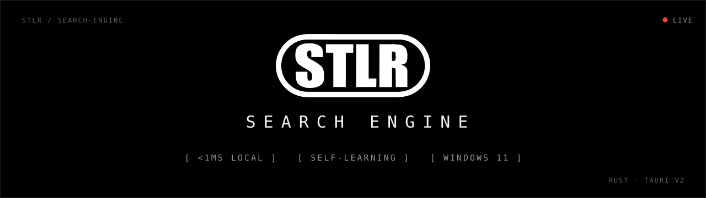
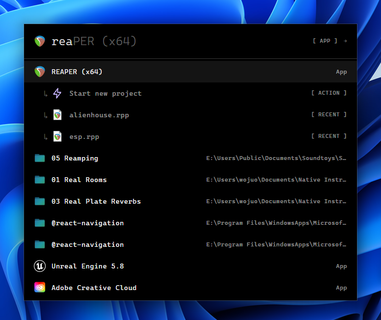
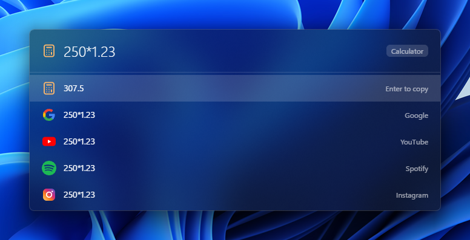
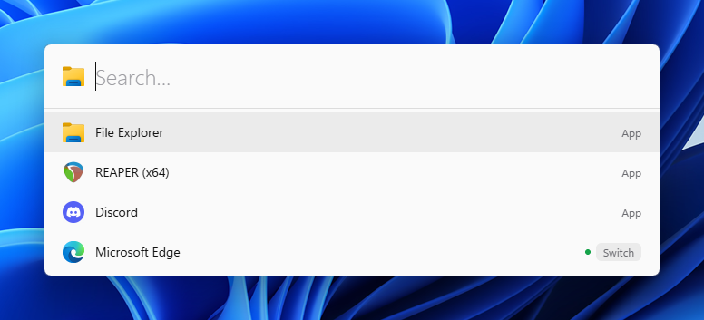
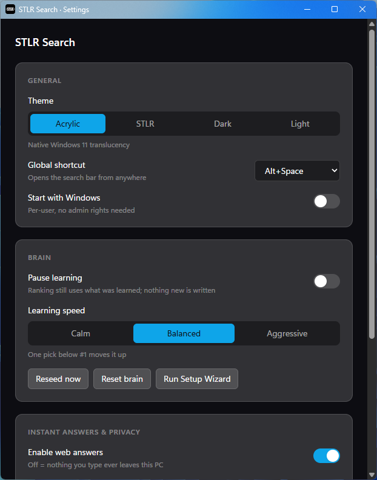

<p align="center">
  
</p>

<p align="center">
  
  
  
  
</p>

**STLR Search** is a keyboard-first launcher for Windows 11. `Alt+Space`, type, `Enter`. It finds apps, files, folders, open browser tabs, bookmarks and system commands in well under a millisecond, and it learns what *you* mean by what you type.

## Why it beats Windows Search and PowerToys Run

- **<1 ms local search.** Apps, bookmarks, tabs and learned results live in RAM (measured ~0.25 ms per keystroke). Files come from [Everything](https://www.voidtools.com/) over native `WM_COPYDATA` IPC: no SDK DLL, no indexer of our own. Network work (answers) is async and never blocks local results. The window is never destroyed, only hidden, so it opens instantly.
- **Self-learning SQLite brain.** Every explicit pick (`Enter`/click, never `Esc`) feeds a WAL-mode SQLite store mirrored in RAM:
  - *Frecency* with exponential decay (configurable half-life).
  - *Skip penalty*: picking #3 boosts it and slightly penalizes #1–#2 for that prefix. One pick is enough to reorder.
  - *Abandon & retype*: type `music`, delete it, pick Spotify within 6 s, and `music` now finds Spotify.
  - *Window context*: the foreground app at `Alt+Space` time (`GetForegroundWindow`) gets its own bonus, so Blender ranks higher when you come from Unreal.
  - *Zero-query*: an empty bar shows your 4 most likely targets right now.
  - *Cold-start seeding*: on first run it reads your pinned taskbar, open windows, startup apps and recent folders, with weights low enough that a single real click overrides them.
  - `/brain`, `/brain pause`, `/brain reseed`, `/brain reset`.
- **Autonomous sub-actions.** When an app is #1, its recent projects appear under it (`↳`). No per-app code: Windows' Recent shortcuts are mapped to their default app with `AssocQueryStringW` (`.rpp` → REAPER, `.blend` → Blender, `.flp` → FL Studio…). Community action packs (`actions.json`) add CLI actions such as `REAPER ↳ Start new project` or `Edge ↳ New InPrivate window`. `→` expands the full list.
- **Live browser tabs and bookmarks.** A tiny Manifest V3 extension streams open tabs over a localhost WebSocket (`127.0.0.1:49152`, extension origins only), so picking a tab focuses it in the right browser window. Edge, Chrome and Brave bookmarks are indexed from their local `Bookmarks` files.
- **Switch, don't duplicate.** If an app already has a window, `Enter` restores and focuses it (`EnumWindows` + exe match) instead of starting a second instance.
- **Instant everything.** Inline calculator (`250*1.23`, `15% of 300`), web routes (Google, YouTube, Spotify URI, Instagram, `Open URL`) that the brain learns like any other target, system commands (`lock`, `sleep`, `shutdown`/`restart` with a two-step confirm, `empty bin`), and compact instant answers from Wikipedia/DuckDuckGo.
- **4 built-in themes.** Acrylic (native Win11 `DWMSBT_TRANSIENTWINDOW`), STLR (pure black, monospace, `[ BRACKETED ]` labels), Dark and Light. They switch live, including native DWM corners and title bar.
- **Privacy-first.** Everything above runs 100% locally. One switch turns off all network answers. Optional bring-your-own-key LLM (Groq, Gemini, any OpenAI-compatible endpoint including a local Ollama), which only ever receives real questions.

## Comparison

| | **STLR Search** | Windows Search | PowerToys Run |
|---|---|---|---|
| Local result latency | **< 1 ms** (RAM + Everything IPC) | Indexer-bound, often 100 ms+ | Fast, plugin-bound |
| Learns from your picks | **Frecency + skip penalty + retype links + context** | No | Selection-history boost |
| Zero-query predictions | **Yes** (context-aware) | Recent / recommended | No |
| Cold-start without history | **Seeds from taskbar, open apps, startup, recent** | n/a | No |
| Focus existing window instead of relaunch | **Yes** | No | Separate Window Walker plugin |
| Open browser tabs | **Yes** (MV3 + local WebSocket) | No | No |
| Browser bookmarks | **Edge / Chrome / Brave** | Edge only (partial) | Via third-party plugins |
| Per-app recent projects & actions | **Autonomous** (`AssocQueryStringW` + `actions.json`) | Jump lists in Start only | Limited context actions |
| Inline calculator | Yes | Yes | Yes |
| Instant answers | Wikipedia / DDG / optional BYOK LLM | Bing (online) | No |
| Works fully offline / no telemetry | **Yes** (one switch) | Bing integration on by default | Yes |
| Themes | **Acrylic, STLR, Dark, Light** | System | Light / Dark |

## Screenshots

| STLR theme: sub-actions | Acrylic theme: calculator |
|---|---|
|  |  |
| **Light theme: zero-query** | **Settings** |
|  |  |

## Installation

**Installer.** Run `STLR Search_<version>_x64-setup.exe` (per-user install, no admin). The app lives in the tray; `Alt+Space` opens it. Turn on *Start with Windows* in the tray menu or in `/settings`.

**Recommended:** install [Everything](https://www.voidtools.com/) for instant file and folder results. Without it, apps, tabs, bookmarks and everything else still work.

**From source** (Node.js, Rust stable MSVC, Visual Studio C++ Build Tools):

```sh
npm install
npm run tauri dev     # development
npm run tauri build   # NSIS installer in src-tauri/target/release/bundle/nsis/
powershell -File scripts/smoke-release.ps1   # release exe must start and stay up (no startup panic)
```

### Browser extension (open tabs)

1. Open `edge://extensions` (or `chrome://`, `brave://`, Opera, Vivaldi) and enable **Developer mode**.
2. **Load unpacked**, then pick the `extension/` folder. `/settings`, *Copy path* gives you the installed location. It connects within seconds; the settings panel shows `Connected: Edge (N tabs)`.

## Usage

| Key | Action |
|---|---|
| `Alt+Space` | Open / close (configurable) |
| `Enter` | Run the selected result (system commands that power off ask twice) |
| `Tab` | Accept the ghost-text completion |
| `↑` `↓` | Move selection (`↑` from the first row selects the answer card) |
| `→` / `←` | Expand / collapse an app's actions and recent projects |
| `Esc` | Hide (never teaches the brain) |
| `Ctrl+Enter` | Open the source of an instant answer |

Commands: `/settings`, `/brain`, `/brain pause`, `/brain resume`, `/brain reseed`, `/brain reset`.

## Customization

All user data lives in `%APPDATA%\com.stlr.searchengine\` and is never written to the repo.

**`settings.json`**: theme, shortcut, learning speed, web answers switch, LLM provider/model/key. Edited by `/settings`; unknown or missing fields fall back to defaults.

**`weights.json`**: optional overrides for the ranking model (any subset):

```json
{
  "half_life_days": 14,
  "pick_first": 1.0,
  "pick_lower": 1.5,
  "skip_penalty": 0.3,
  "retype_gain": 1.0,
  "retype_window_secs": 6,
  "context_weight": 0.5,
  "pin_threshold": 1.0,
  "seed_scale": 0.2
}
```

The *Calm / Balanced / Aggressive* switch in settings rewrites the `pick_*`, `skip_penalty` and `pin_threshold` keys and keeps the rest.

**`links.json`**: your own named links. They rank above any app or bookmark with an equally good match (type `st` and `STELLAR ARCHIVE` is first). Like any bookmark, picking one switches to its tab if it is already open (needs the extension), otherwise opens it; `"browser": "Edge"` opens it in Edge even when Edge isn't the default browser:

```json
[{ "name": "STELLAR ARCHIVE", "url": "https://drive.google.com/drive/folders/...", "browser": "Edge" }]
```

**`actions.json`**: replaces the bundled [community action packs](actions.json). A pack matches an indexed app by exe file name or Start Menu name; an action runs the app's exe with `args` or opens a `uri`:

```json
{
  "packs": [
    {
      "exe": ["reaper.exe"],
      "actions": [{ "name": "Start new project", "args": ["-new"] }]
    },
    {
      "names": ["discord"],
      "actions": [{ "name": "Direct Messages & Friends", "uri": "discord://-/channels/@me" }]
    }
  ]
}
```

PRs with new packs are welcome.

## Architecture

```
src-tauri/src/
  lib.rs          commands, windows, ranking glue (rerank, pinning, children)
  brain.rs        SQLite (WAL) + RAM mirror: frecency, skip penalty, retype links, context, seeding
  apps.rs         Start Menu index (.lnk/.exe) + fuzzy scoring
  everything.rs   Everything IPC over WM_COPYDATA (no DLL)
  subactions.rs   recent projects via AssocQueryStringW + actions.json packs
  tabs.rs         localhost WebSocket bridge for the MV3 extension
  bookmarks.rs    Chromium Bookmarks JSON (Edge / Chrome / Brave, all profiles)
  switcher.rs     foreground context, EnumWindows switch-to-window, .lnk / MSIX resolution
  icons.rs        native icons (IShellItemImageFactory, MSIX logos) cached as PNG
  answers.rs      AnswerProvider trait: DuckDuckGo, Wikipedia, optional LLM
  routes.rs calc.rs commands.rs seeder.rs settings.rs autostart.rs tray.rs clipboard.rs
src/              React + Tailwind UI (search bar, settings window, themes)
extension/        Manifest V3 tabs bridge
```

Run the tests with `cargo test` in `src-tauri/` (live-system checks are `#[ignore]`d: `cargo test -- --ignored --nocapture`).

## License

[MIT](LICENSE) © 2026 vrouz
